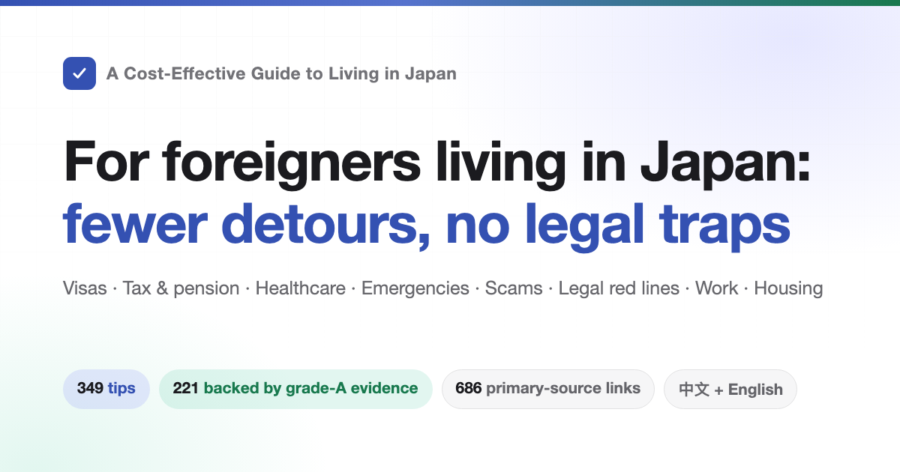

# A Cost-Effective Guide to Living in Japan

Original title: 在日本的高性价比生活指南

A practical guide for foreign residents of Japan: keeping your residence status safe, paying and reclaiming taxes and pension, getting medical care for less, and what to do in an emergency. It also covers what can get you scammed, arrested, or stripped of your status in Japan. 
349 pieces of advice across 26 sections. Each one states what it costs, what you get back, and how strong the evidence is. Sources are limited to journal papers and official documents.

 

### [Open the online search page](https://masteren.github.io/HowToLiveBetter-JP/)

> **The book is written in Simplified Chinese, and every entry has been translated into English.** Where the two differ, the Chinese text is authoritative. Japanese rules on immigration and social insurance change often. Every entry carries an "as of" date, so check the official page again before you act.

---

## What this is

The book is written for foreigners living in Japan who read Chinese. Readers come from mainland China, Taiwan, Hong Kong, Singapore, Malaysia and elsewhere, so the text does not assume any one nationality.

Every entry answers two questions: what you spend (money, time, effort, willpower), and what you get back. The return is one of four kinds, and the kinds are never converted into each other:

- **Life**: lower all-cause mortality, or a lower risk from a specific cause of death
- **Time and energy**: fewer wasted trips and fewer rounds between government counters
- **Money**: less money wasted, and the benefits and refunds you are entitled to
- **Personal freedom**: not being arrested, losing your residence status, or being deported because you did not know a rule

Within each section, entries are ordered by cost-effectiveness rather than by topic. Things that cost almost nothing and help a lot come first.

Each entry has the same fields:

| Field | Content |
| --- | --- |
| Cost | Money, time, and willpower it takes |
| Plain language | The benefit restated in everyday words, with nothing added |
| Benefit | The figures from the source, unchanged |
| Evidence grade | A, B or C, see below |
| Sources | DOI or PubMed links, or official Japanese documents |
| Notes | Disputes, who it applies to, caveats |

## Evidence grades

| Grade | Meaning |
| --- | --- |
| A | Quantified evidence. Medical entries come from meta-analyses, large cohorts or RCTs. Legal and administrative entries come from the statute or an official document that states the figure, checked against the original. |
| B | Supported by research but hard to quantify, or resting on a small or single study. For administrative entries, an official document exists but the figure is set by each municipality. |
| C | Author experience or common consensus, with no direct literature. |

Disputed A and B entries are marked 争议 (disputed) and list the evidence against.

Only primary sources are cited: journal papers, Japanese statutes on e-Gov, and pages of ministries, agencies and municipalities. Secondary write-ups, including promotional pages of visa agencies and law offices, are not used. How each source was checked is recorded in [docs/核实记录](docs/核实记录/).

## Contents

The Chinese text is authoritative. Each English entry records which Chinese version it was translated from, and an automatic check flags entries whose Chinese text has changed since; the online search page marks those entries until they are retranslated.

| # | Section | Read |
| --- | --- | --- |
| 1 | Don't die early | [English](en/01-dont-die-early.md) · [中文](book/01-不要早死.md) |
| 2 | Residence status: keep your visa out of trouble | [English](en/02-residence-status.md) · [中文](book/02-在留资格.md) |
| 3 | Emergencies: what to do first | [English](en/03-emergencies.md) · [中文](book/03-紧急情况.md) |
| 4 | Tax and pension: what you pay and how to get it back | [English](en/04-tax-and-pension.md) · [中文](book/04-税和年金.md) |
| 5 | Japan's legal red lines | [English](en/05-legal-red-lines.md) · [中文](book/05-日本的法律红线.md) |
| 6 | Seeing a doctor: health insurance and lower medical bills | [English](en/06-seeing-a-doctor.md) · [中文](book/06-看病.md) |
| 7 | Work: wages, overtime pay, dismissal and workplace injury | [English](en/07-work.md) · [中文](book/07-工作.md) |
| 8 | Renting and moving: deposits, agent fees and guarantors | [English](en/08-renting-and-moving.md) · [中文](book/08-租房与搬家.md) |
| 9 | When money runs out: unemployment benefits, exemptions, emergency loans and public assistance | [English](en/09-when-money-runs-out.md) · [中文](book/09-没钱的时候怎么活.md) |
| 10 | Scams and consumer disputes | [English](en/10-scams-and-consumer-disputes.md) · [中文](book/10-防骗.md) |
| 11 | Marriage, divorce and residence status | [English](en/11-marriage-divorce-and-residence.md) · [中文](book/11-结婚离婚与在留.md) |
| 12 | Pregnancy, childbirth and newborns | [English](en/12-pregnancy-birth-and-newborns.md) · [中文](book/12-怀孕生产和新生儿.md) |
| 13 | School-age children | [English](en/13-school-age-children.md) · [中文](book/13-上学以后的孩子.md) |
| 14 | Studying in Japan | [English](en/14-studying-in-japan.md) · [中文](book/14-在日本读书.md) |
| 15 | Parents and older relatives | [English](en/15-parents-and-older-relatives.md) · [中文](book/15-父母和老人.md) |
| 16 | After someone dies | [English](en/16-after-someone-dies.md) · [中文](book/16-有人去世之后.md) |
| 17 | Permanent residence, naturalization and leaving Japan | [English](en/17-permanent-residence-naturalization-leaving.md) · [中文](book/17-永住归化和离开日本.md) |
| 18 | Starting and running a business | [English](en/18-starting-a-business.md) · [中文](book/18-开公司做生意.md) |
| 19 | Legal red lines for programmers and engineers | [English](en/19-red-lines-for-engineers.md) · [中文](book/19-程序员和技术人的红线.md) |
| 20 | Don't die slowly: smoking, alcohol, exercise, sleep and diet | [English](en/20-dont-die-slowly.md) · [中文](book/20-不要慢慢死.md) |
| 21 | Medicines at home | [English](en/21-medicines-at-home.md) · [中文](book/21-家里的常备药.md) |
| 22 | Not worth it: things that look valuable but aren't | [English](en/22-not-worth-it.md) · [中文](book/22-反面清单.md) |
| 23 | After a major loss or shock | [English](en/23-after-a-major-loss.md) · [中文](book/23-遭遇重大打击之后.md) |
| 24 | Don't waste energy | [English](en/24-dont-waste-energy.md) · [中文](book/24-不要浪费精力.md) |
| 25 | Don't waste time | [English](en/25-dont-waste-time.md) · [中文](book/25-不要浪费时间.md) |
| 26 | Driving and driver's licenses | [English](en/26-driving-and-licenses.md) · [中文](book/26-开车和驾照.md) |

## Glossary

The text uses everyday language where it can, but citing research brings in a few statistical terms. If something is unclear, look it up here; on the online search page, hovering over a word with a dotted underline (or tapping it on a phone) also shows the explanation.

Show 27 terms (all-cause mortality, HR, RR, 95% CI, meta-analysis, residence card, deportation…)

| Term | Meaning |
| --- | --- |
| All-cause mortality | The proportion of a group who die over a period, from any cause. This book uses it to measure "living longer" |
| HR | Hazard ratio. Over the same period, how fast events happen in the group that did something, divided by the group that did not. HR 0.87 means 13% lower than the group that did not; HR 1.21 means 21% higher |
| RR | Relative risk. The ratio of the chance of an event in two groups, read the same way as HR |
| OR | Odds ratio. Also a comparison of two groups; when the event is rare it is close to RR, and when it is common it overstates the gap |
| Risk difference | The chance of an event in one group minus the other, giving "how many extra per thousand people" directly |
| 95% CI | 95% confidence interval. The range in which the true value very likely lies. For ratios, a range crossing 1, and for differences, a range crossing 0, means the gap between groups may be chance |
| RCT | Randomized controlled trial. People are split into two groups by something like drawing lots; one group does the thing and one does not, and the outcomes are compared |
| Meta-analysis | Recalculating the results of many studies together to get one overall figure |
| Cohort | Cohort study. A large group of people is followed for many years and events are recorded. It can show two things often occur together, but is not enough to prove the first caused the second |
| Observational | Observational study. Researchers only record, without deciding who does what. Results are easily skewed by other factors, so discount the figures |
| Confounding | A third factor drives both the cause and the effect, making two things look causally linked |
| Reverse causation | The direction of cause is reversed: it looks as if the first causes the second, but really the second causes the first |
| BMI | Body mass index: weight in kilograms divided by height in metres squared |
| AED | Automated external defibrillator. Switch it on and follow the voice prompts; it decides by itself whether to shock |
| CPR | Cardiopulmonary resuscitation. Pressing hard on the chest when the heart stops, to keep blood flowing |
| Residence card | 在留カード. The card issued by immigration to foreigners living in Japan mid- to long-term, showing status and period of residence |
| Status of residence | 在留資格. Decides what you may do in Japan, such as work, study or living as family; different statuses allow different things |
| Immigration | The Immigration Services Agency of Japan (出入国在留管理庁) and its regional bureaus, which handle residence procedures |
| Mid- to long-term resident | 中長期在留者. Foreigners living in Japan with a residence card. Short-term visitors and people with a period of stay of 3 months or less are not included |
| Appended Table I status | Statuses listed in Appended Table I of the Immigration Act, defined by what you "do" in Japan, such as work, study or Dependent. Status-based ones such as Permanent Resident or Spouse of Japanese National are in Appended Table II |
| Permission for activities outside status | 資格外活動許可. Permission from immigration for students and Dependent visa holders to work part-time outside their status. Working without it is illegal |
| Deportation | 退去強制. Immigration forcing a foreigner to leave Japan. After deportation you cannot re-enter for a period |
| Imprisonment (拘禁刑) | The prison sentence in Japan's Penal Code. From 2025 the former penal servitude and imprisonment without work were merged into this one |
| Fine (罰金) | A criminal penalty in Japan that gives you a criminal record. Not the same as a traffic infraction payment (反則金) or an administrative non-penal fine (過料) |
| Designated Activities | 特定活動. A status where the Minister of Justice designates the activities for each person. Job hunting after graduating, waiting to start a job, and wide-ranging work for graduates of Japanese universities all use it, with different conditions |
| Holder of parental authority | 親権者. The parent who has the right and duty to care for, educate and manage the property of a minor child. From April 2026, after divorce this can be both parents or one |
| Houterasu (法テラス) | Japan Legal Support Center. A state-established legal support body offering free legal consultation and advance payment of lawyers' fees to people with income below a threshold |

## License

The text (book/, docs/ and the READMEs) is released under [CC BY 4.0](LICENSE). The code (tools/, index.html and .github/) is released under [MIT](LICENSE-CODE).

This book is adapted from [《高性价比人生指南》 (HowToLiveBetter)](https://github.com/eternity4719/HowToLiveBetter) by eternity4719, whose text is also CC BY 4.0 and code MIT. The method of accounting costs and benefits and the medical entries come from the original. The legal and administrative parts were rewritten for current Japanese rules, and content for foreign residents of Japan was added.

If you share or adapt this book, credit "在日本的高性价比生活指南" with a link to https://github.com/masteren/HowToLiveBetter-JP , keep the credit to the original book, and link the license https://creativecommons.org/licenses/by/4.0/ .
