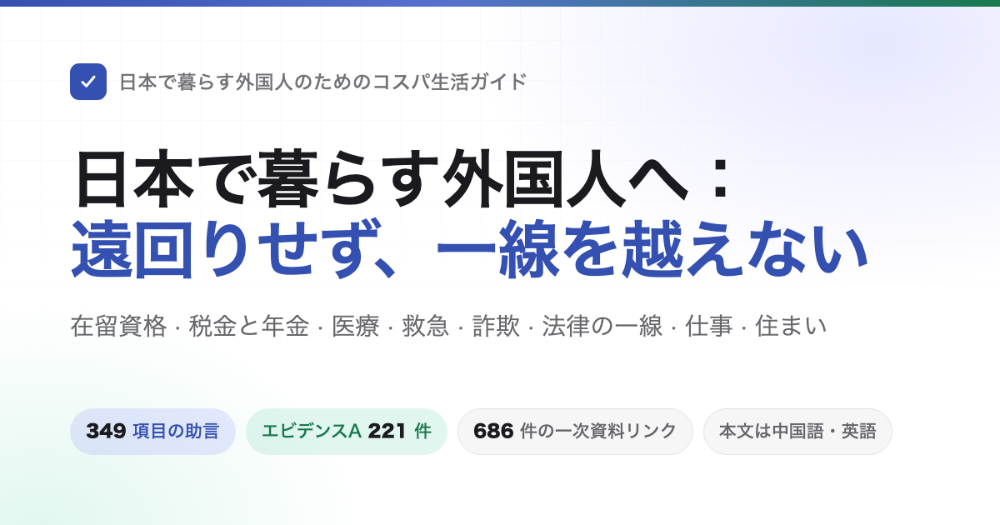

# 日本で暮らす外国人のためのコスパ生活ガイド

原題：在日本的高性价比生活指南

日本で暮らす外国人向けの実用ガイドです。在留資格でつまずかない方法、税金と年金の払い方と取り戻し方、医療費を抑える方法、事故や急病のときの対処をまとめています。詐欺、逮捕、在留資格の取消しにつながる行為も取り上げています。 
26 節・349 項目の助言を収録しています。各項目に、何を払い何が返ってくるか、根拠（エビデンス）がどれだけ確かかを書いています。出典は学術論文と公的文書に限っています。

 

### [オンライン検索ページを開く](https://masteren.github.io/HowToLiveBetter-JP/)

> **本文は簡体字中国語で書かれています。** 全項目の英訳もあります（[English](README.en.md)）。日本語訳はありません。このページは日本語の案内です。入管や社会保険の制度はよく変わります。各項目に「いつ時点の情報か」を書いているので、手続きの前に公式ページをもう一度確認してください。

---

## このガイドについて

中国語が読める、日本在住の外国人に向けて書いています。読者は中国大陸、台湾、香港、シンガポール、マレーシアなどさまざまなので、特定の国籍を前提にしていません。

各項目は二つの問いに答えます。何を払うか（お金・時間・手間・根気）、そして何が返ってくるかです。返ってくるものは次の四種類で、種類どうしを換算することはしません。

- **寿命**：総死亡率や特定の死因のリスクが下がる
- **時間と気力**：無駄な移動や窓口のたらい回しが減る
- **お金**：無駄な出費が減り、受け取れる給付や還付を受け取れる
- **身体の自由**：ルールを知らなかったために逮捕、在留資格の取消し、退去強制にならない

各節の中では、分野ではなくコストパフォーマンスの順に並べています。ほとんどコストがかからず効果が大きいものが先です。

各項目は同じ形式で書いています。

| 欄 | 内容 |
| --- | --- |
| コスト | お金・時間・根気がどれだけ要るか |
| わかりやすく言うと | 結果を日常の言葉で言い直したもの。新しい数字は足さない |
| 効果 | 出典の数字をそのまま載せる |
| エビデンスレベル | A・B・C（下記） |
| 出典 | DOI や PubMed のリンク、または日本の公的文書 |
| 備考 | 異論、対象者、注意点 |

## エビデンスレベル

| レベル | 意味 |
| --- | --- |
| A | 定量的な根拠がある。医学の項目はメタアナリシス、大規模コホート、RCT に基づく。制度の項目は法令の原文や公的文書に具体的な数字があり、原文と照合済み。 |
| B | 研究の裏付けはあるが数量化しにくい、または小規模・単一の研究しかない。制度の項目は公的文書があるが、具体的な数字は自治体ごとに決まる。 |
| C | 著者の経験や一般的な合意で、直接の文献はない。 |

異論のある A・B の項目には「争议」（異論あり）と明記し、反対側の根拠も挙げています。

出典は一次資料に限っています。学術論文、e-Gov 法令検索の法令原文、省庁や自治体の公式ページです。ビザ代行業者や法律事務所の宣伝ページを含む二次情報は使っていません。出典の確認経過は [docs/核实记录](docs/核实记录/) に記録しています。

## 目次

各節のファイルは中国語です。英訳は [README.en.md](README.en.md) の目次から読めます。

| # | 節 | ファイル |
| --- | --- | --- |
| 1 | 早死にしないために | [01](book/01-不要早死.md) |
| 2 | 在留資格：ビザで失敗しない | [02](book/02-在留资格.md) |
| 3 | 緊急時：まず何をするか | [03](book/03-紧急情况.md) |
| 4 | 税金と年金：いくら払い、どう取り戻すか | [04](book/04-税和年金.md) |
| 5 | 日本の法律で越えてはいけない一線 | [05](book/05-日本的法律红线.md) |
| 6 | 病院にかかる：健康保険と医療費を抑える方法 | [06](book/06-看病.md) |
| 7 | 仕事：賃金、残業代、解雇、労災 | [07](book/07-工作.md) |
| 8 | 賃貸と引越し：敷金、仲介手数料、保証人 | [08](book/08-租房与搬家.md) |
| 9 | お金がないとき：失業給付、保険料の免除、緊急小口資金、生活保護 | [09](book/09-没钱的时候怎么活.md) |
| 10 | 詐欺と消費者トラブル | [10](book/10-防骗.md) |
| 11 | 結婚、離婚と在留資格 | [11](book/11-结婚离婚与在留.md) |
| 12 | 妊娠、出産、新生児 | [12](book/12-怀孕生产和新生儿.md) |
| 13 | 学校に通う年齢の子ども | [13](book/13-上学以后的孩子.md) |
| 14 | 日本で学ぶ | [14](book/14-在日本读书.md) |
| 15 | 親と高齢の家族 | [15](book/15-父母和老人.md) |
| 16 | 家族が亡くなったあと | [16](book/16-有人去世之后.md) |
| 17 | 永住、帰化、日本を離れるとき | [17](book/17-永住归化和离开日本.md) |
| 18 | 起業と事業 | [18](book/18-开公司做生意.md) |
| 19 | プログラマーと技術者が越えてはいけない一線 | [19](book/19-程序员和技术人的红线.md) |
| 20 | ゆっくり死なないために：たばこ、酒、運動、睡眠、食事 | [20](book/20-不要慢慢死.md) |
| 21 | 家庭の常備薬 | [21](book/21-家里的常备药.md) |
| 22 | お金や手間をかけなくていいもの：価値がありそうで実はないもの | [22](book/22-反面清单.md) |
| 23 | 大きな喪失や衝撃に見舞われたあと | [23](book/23-遭遇重大打击之后.md) |
| 24 | 気力を無駄にしない | [24](book/24-不要浪费精力.md) |
| 25 | 時間を無駄にしない | [25](book/25-不要浪费时间.md) |
| 26 | 車の運転と運転免許 | [26](book/26-开车和驾照.md) |

## ライセンス

本文（book/、docs/、各 README）は [CC BY 4.0](LICENSE)、コード（tools/、index.html、.github/）は [MIT](LICENSE-CODE) で公開しています。

このガイドは eternity4719 による[《高性价比人生指南》（HowToLiveBetter）](https://github.com/eternity4719/HowToLiveBetter)を翻案したものです。原著の本文も CC BY 4.0、コードも MIT で公開されています。コストと効果の数え方と医学の項目は原著を引き継いでいます。法律と制度の部分は日本の現行制度に合わせて書き直し、日本在住の外国人向けの内容を加えました。

転載や翻案の際は「在日本的高性价比生活指南」とリポジトリへのリンク https://github.com/masteren/HowToLiveBetter-JP を明記し、原著のクレジットも残したうえで、ライセンスへのリンク https://creativecommons.org/licenses/by/4.0/ を付けてください。
